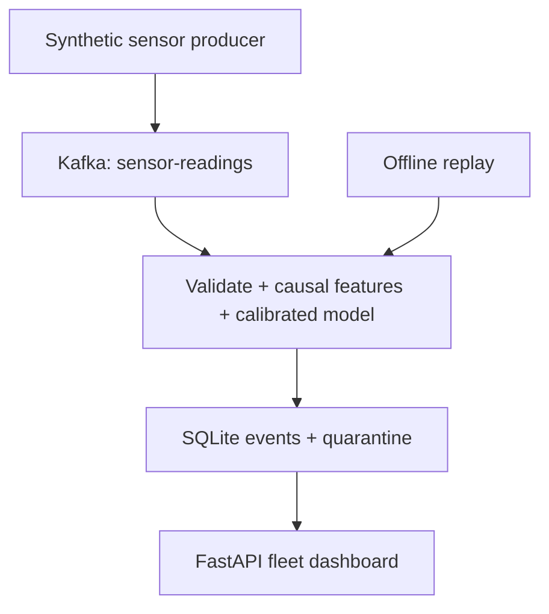
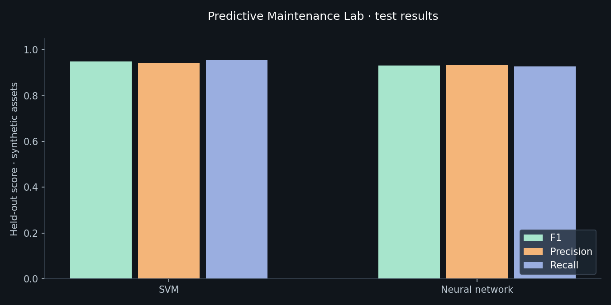

# Predictive Maintenance Lab

[](https://github.com/zohaibjan/predictive-maintenance-lab/actions/workflows/tests.yml)

**Sensor data → causal feature engineering → failure-risk prediction → human review.**

An end-to-end public reference project with Kafka ingestion, SVM and neural-network classifiers, MLflow experiment tracking, a FastAPI scoring service and an interactive fleet-health dashboard.

All data is **synthetic**. The project is an original demonstration of engineering methods, contains no private source code or operational records, and makes no claim of production deployment or real equipment reliability gains.

## Start the local demo

Python 3.12 is tested. No GPU, external credentials or paid service is needed.

```bash
python -m venv .venv
source .venv/bin/activate       # Windows: .venv\Scripts\activate
pip install -r requirements.txt
python run_demo.py
```

Open **http://127.0.0.1:8000**. The launcher trains both models when needed, records their experiments in local MLflow, scores an independent demo fleet and starts the dashboard. First training takes longer than subsequent starts. Use `python run_demo.py --retrain` to replace the local model after changing training code.

The dashboard provides:

- Fleet risk ranking and priority/watch/normal status, based on the validation-selected threshold.
- Search, status filters, keyboard-selectable asset rows and per-asset risk history.
- Sensor context, synthetic supplier prior and basic training-range flags.
- SVM versus neural-network metrics, with the validation-selected model identified.
- A separate pipeline view, visible synthetic-data labelling and human-review guidance.

Dashboard refresh reads stored scores every 15 seconds; it does not generate new telemetry. Offline replay is a finite batch. Run the Kafka producer to add its independent `stream-*` fleet. The simulator's timestamps are intentionally fixed; no live physical assets are connected.

## Architecture



Model development runs separately: asset-disjoint train/calibration/validation/test → fitted pipeline and thresholds → MLflow metrics/artifacts → trusted local model bundle. The consumer and API use the same scoring service and feature implementation.

## What the model predicts

The binary target is **failure within the next 12 simulated hours** for an asset not yet failed. Synthetic trajectories resemble pump-like telemetry: temperature, vibration, pressure and load change as a simulated failure approaches. This is an illustrative generator, not a validated physical model.

Features include current measurements, an independently generated supplier historical fault rate, six-reading rolling temperature/vibration means, vibration trend and pressure change. Window means use at most six readings; at the hourly simulation cadence this is six readings over the preceding five elapsed hours. The trend divides by actual elapsed time. Irregular or missing readings change the window duration; resampling would be needed for a fixed-time production window.

Failure time, future readings, asset ID and labels are excluded from model inputs. Supplier history is a separate synthetic prior; it is not computed from the held-out asset's future failures.

## Model selection and leakage controls

The 120 assets are partitioned once, with every reading from an asset kept in one group:

| Group | Assets | Purpose |
|---|---:|---|
| Training | 60 | Fit scalers and SVM/MLP models |
| Calibration | 20 | Sigmoid calibration with frozen fitted estimators |
| Validation | 20 | Select probability threshold and model using F1 |
| Final test | 20 | Report metrics after all selections are fixed |

The SVM uses an RBF kernel and balanced class weights. The neural network has hidden layers of 24 and 12 units. Both use training-only standardisation. Threshold candidates range from 0.10 to 0.90 in 0.05 increments. Hyperparameters are fixed rather than selected using test scores.

Reported metrics include F1, precision, recall, ROC-AUC, average precision, Brier score and confusion matrices. Metrics are per reading; readings within an asset are correlated. A separate asset split is not an evaluation of future time periods or unseen supplier populations. Real deployment would need representative real labels, temporal evaluation and further calibration testing.

See the [recorded results](results/README.md) and [full metrics, split asset IDs and seed](results/metrics.json).



The selected neural network's test F1 was approximately 0.931 on this synthetic run; the SVM's test F1 was approximately 0.950. The neural network remains selected because it won validation F1. These results do not establish real-world accuracy or maintenance savings.

## Kafka mode with Docker Compose

Docker Engine and Compose are needed for this route. Run from the repository root:

```bash
# Train and persist the trusted model first.
docker compose run --rm train

# Start broker, initialise topic, score incoming events and serve the dashboard.
docker compose up -d kafka init-topic api consumer

# Replay an independent stream fleet through real Kafka.
docker compose run --rm producer
```

Open http://127.0.0.1:8000. Kafka is pinned to the official Apache 4.0.2 image. Events are keyed by asset to preserve order within a partition. The consumer commits offsets only after scoring/storage succeeds or a malformed/late event is durably quarantined. Exact duplicate event IDs return the stored score; conflicting IDs and late timestamps are rejected. Storage failures propagate before offset commit so messages can be retried.

This is an at-least-once demonstration with idempotent storage, not a claim of Kafka exactly-once semantics. Stop the local services with `docker compose down`. Local files in `runtime/` remain available between runs.

## Run each stage separately

```bash
python -m maintenance.train --tracking-uri sqlite:///runtime/mlflow.db
python -m maintenance.replay
python -m uvicorn maintenance.api:app --host 127.0.0.1 --port 8000

# With a separately running local Kafka broker and sensor-readings topic:
python -m maintenance.stream consume --bootstrap localhost:9092
python -m maintenance.stream produce --bootstrap localhost:9092
```

The consumer is long-running; the producer sends a finite replay. Start the consumer in a separate terminal. `MODEL_PATH`, `DATABASE_PATH` and `KAFKA_BOOTSTRAP` configure the consumer. The API also accepts `METRICS_PATH`. API documentation is at `/docs`.

## MLflow tracking

`runtime/mlflow.db` contains two tracked model runs. Each includes seed, horizon, threshold, validation/test metrics and the metrics report. The selected model bundle is logged as a trusted local artifact. This project uses `mlflow-skinny` and its SQLite backend dependencies; it does not bundle an MLflow UI server.

```python
from mlflow import MlflowClient
client = MlflowClient(tracking_uri="sqlite:///runtime/mlflow.db")
experiment = client.get_experiment_by_name("synthetic-predictive-maintenance")
for run in client.search_runs([experiment.experiment_id]):
    print(run.data.params["model"], run.data.metrics["test_f1"])
```

## Validation and limits

```bash
python -m pytest -q
node --check static/app.js      # optional JavaScript syntax check; Node is not needed to serve the app

# With Kafka running:
RUN_KAFKA_TEST=1 python -m pytest -q tests/test_pipeline.py -k real_kafka
```

See [validation evidence](docs/validation.md) for checks actually performed and remaining verification. The [GitHub Actions validation run](https://github.com/zohaibjan/predictive-maintenance-lab/actions/runs/41017185745) passed Python tests, training, replay, Docker-based Kafka/topic startup and real Kafka transport integration. Full application-container and browser checks remain separate.

The browser interface uses plain JavaScript and CSS with no frontend build step. Font loading is optional; local system fonts provide a fallback. Node is only used for the optional syntax check.

## Boundaries and further work

- Range flags count input features beyond three training standard deviations. They are basic diagnostics, not proof of data drift, concept drift or model degradation.
- Retraining and promotion are manual. There is no automatic rollback, model registry promotion or feedback-label workflow yet.
- No authentication, TLS or Kafka security configuration is included. Keep the demo local; the launcher and Compose host ports bind to loopback. Add access controls before exposing it.
- SQLite supports this small single-host demonstration. Multi-worker event-time buffering, schema registry, backpressure, alert deduplication, operational dashboards and production observability remain future work.
- Model artifacts use joblib. Load only artifacts from a trusted source.

## Technical references

- [Apache Kafka Docker quickstart](https://kafka.apache.org/40/getting-started/docker/)
- [Scikit-learn probability calibration](https://scikit-learn.org/stable/modules/calibration.html)
- [MLflow tracking APIs](https://mlflow.org/docs/latest/ml/tracking/tracking-api/)
